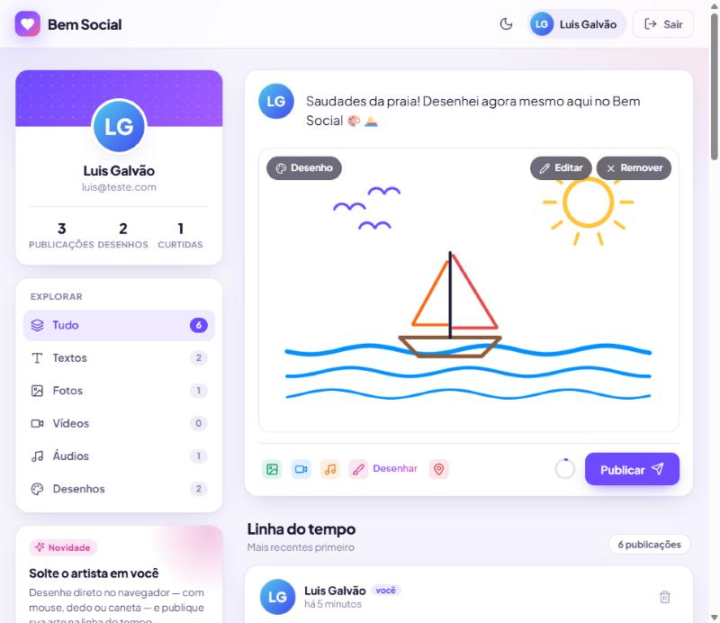
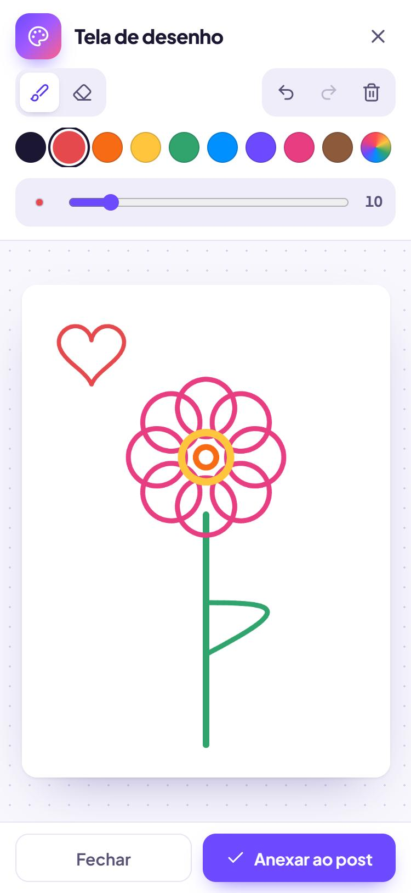
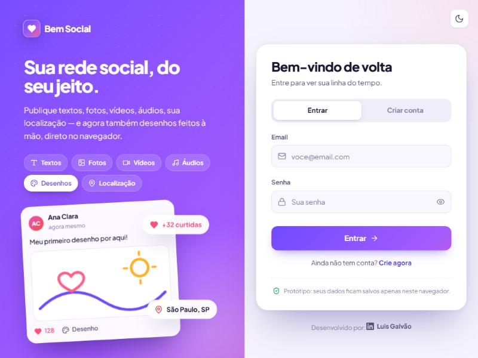
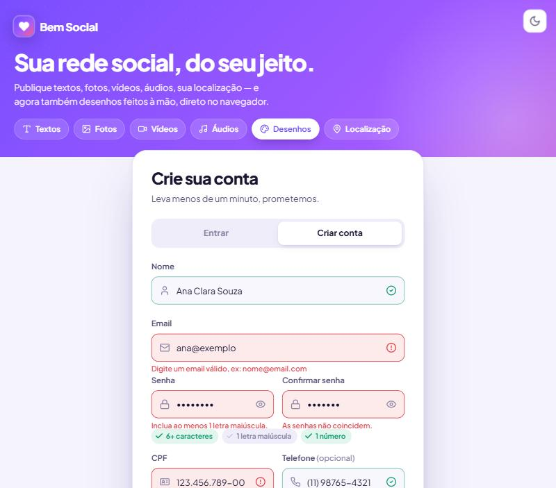
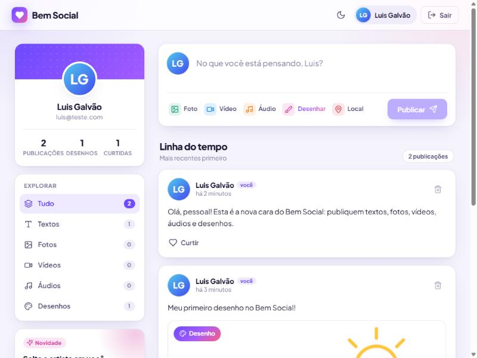
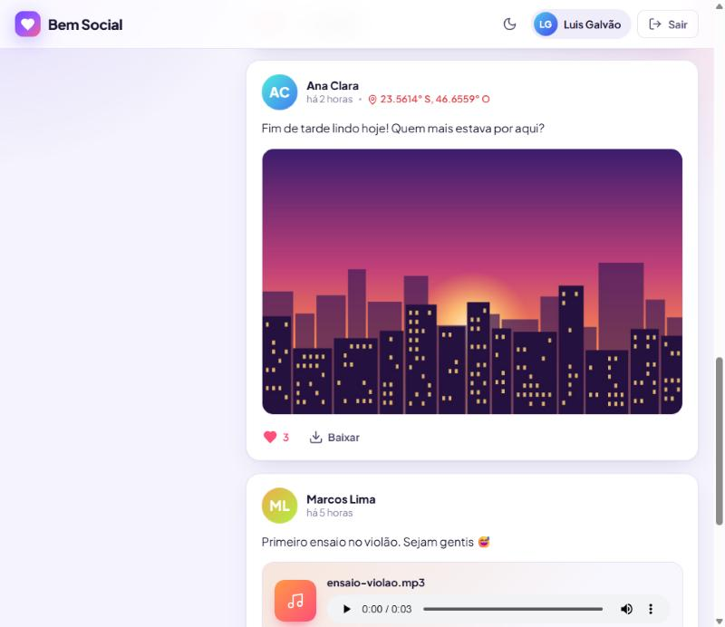
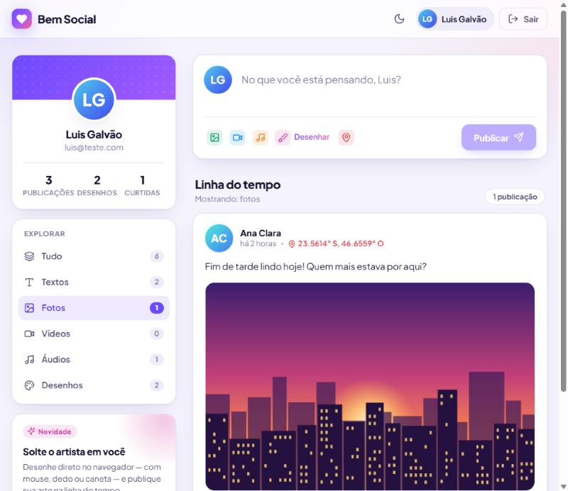
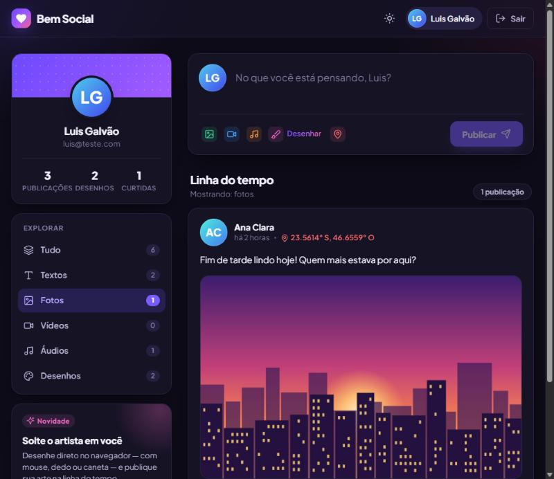

<div align="center">


# Bem Social

### Sua rede social, do seu jeito.

Uma rede social que roda **inteira no navegador** — publique textos, fotos, vídeos, áudios, sua localização e até **desenhos feitos à mão**.

<br>


<br>

<table>
  <tr>
    <td></td>
    <td></td>
  </tr>
</table>

**[Sobre](#-sobre-o-projeto)** ·
**[Destaques](#-destaques)** ·
**[Tour](#-tour-pelas-funcionalidades)** ·
**[Requisitos](#-requisitos-do-projeto)** ·
**[Como rodar](#-como-rodar)** ·
**[Tecnologias](#-tecnologias)** ·
**[Estrutura](#-estrutura-do-projeto)** ·
**[Autor](#-autor)**

</div>

---

## 📌 Sobre o projeto

O **Bem Social** é o projeto da disciplina de *Web Standards* do curso de **Aplicações Ricas**.

O enunciado conta a história do **Seu Tadeu**, um homem recém-aposentado que se encantou com as redes sociais e decidiu criar a sua. Com um orçamento curto, ele precisava de um **protótipo moderno, animado e atraente** para apresentar a investidores — e queria inovar com publicações multimídia, indo além do texto.

O resultado é uma rede social completa que funciona **sem servidor**: contas, sessão, publicações e arquivos ficam guardados no próprio navegador.

> [!NOTE]
> É um protótipo: não existe back-end. Os dados ficam salvos **apenas no navegador** de quem usa (localStorage + IndexedDB). Não use senhas reais.

---

## 🌟 Destaques

<table>
  <tr>
    <td width="33%" valign="top">
      <h3>🎨 Desenhe e publique</h3>
      Uma tela de desenho completa, com pincel, borracha, cores, espessura e desfazer — no mouse, no dedo ou na caneta.
    </td>
    <td width="33%" valign="top">
      <h3>🎞️ Multimídia</h3>
      Publique texto, foto (JPG/PNG), vídeo (MP4), áudio (MP3) e a sua localização atual.
    </td>
    <td width="33%" valign="top">
      <h3>🔐 Cadastro validado</h3>
      Validação em tempo real, máscaras de CPF e telefone e checagem dos dígitos verificadores do CPF.
    </td>
  </tr>
  <tr>
    <td valign="top">
      <h3>🌓 Tema claro e escuro</h3>
      Segue o tema do sistema e pode ser trocado com um clique.
    </td>
    <td valign="top">
      <h3>📱 Responsivo</h3>
      Layout em duas colunas no computador e adaptado para o celular, com desenho em tela cheia.
    </td>
    <td valign="top">
      <h3>✨ Animado</h3>
      Transições entre telas, entrada dos posts, curtidas com “pop”, toasts e muito mais.
    </td>
  </tr>
</table>

---

## ✨ Tour pelas funcionalidades

### 1. Acesso: login e cadastro

Uma única tela com abas animadas para **Entrar** e **Criar conta**. Cada campo é validado enquanto você digita, com mensagens claras e ícones de status. A senha tem um checklist que vai “acendendo” conforme as regras são cumpridas.

<table>
  <tr>
    <td align="center"><b>Login</b></td>
    <td align="center"><b>Cadastro com validação em tempo real</b></td>
  </tr>
  <tr>
    <td></td>
    <td></td>
  </tr>
</table>

| Campo | Regras |
| --- | --- |
| **Nome** | Obrigatório · 3 a 50 letras · apenas letras (aceita acentos) |
| **Email** | Obrigatório · formato válido · máximo de 30 caracteres · não pode repetir |
| **Senha** | Obrigatória · mínimo de 6 caracteres · ao menos 1 letra maiúscula e 1 número |
| **Confirmar senha** | Precisa ser igual à senha |
| **CPF** | Obrigatório · máscara `000.000.000-00` · só números · **dígitos verificadores** · não pode repetir |
| **Telefone** | Opcional · máscara `(00) 00000-0000` · valida DDD, celular (9 dígitos) e fixo |

Também tem: mostrar/ocultar senha, animação de “balançar” quando há erro, redirecionamento automático para a linha do tempo e botão **Sair**.

---

### 2. Linha do tempo



- Só aparece para quem está logado — sem sessão, o visitante volta para o login.
- Publicações em **ordem decrescente**: a mais nova sempre no topo.
- Tempo relativo (“agora mesmo”, “há 2 horas”) que se atualiza sozinho; passe o mouse para ver a data completa.
- **Cartão de perfil** com avatar gerado pelas iniciais e estatísticas: publicações, desenhos e curtidas recebidas.
- **Curtir** com animação, **baixar** fotos e desenhos, e **excluir** as próprias publicações — com botão **Desfazer** caso tenha sido sem querer.

---

### 3. Publicações multimídia

Cada publicação é exibida de acordo com o que ela contém: texto, mídia e/ou localização.



| Tipo | Detalhes |
| --- | --- |
| 📝 **Texto** | Até 2000 caracteres · espaços sobrando no começo e no fim são removidos · texto só com espaços é bloqueado · medidor circular de caracteres |
| 🖼️ **Foto** | Arquivos **JPG** ou **PNG** |
| 🎬 **Vídeo** | Arquivos **MP4**, com player embutido |
| 🎵 **Áudio** | Arquivos **MP3**, em um cartão com o nome do arquivo e player |
| 🎨 **Desenho** | Criado na tela de desenho e anexado como imagem PNG |
| 📍 **Localização** | Coordenadas atuais do usuário, com link para abrir no mapa |

> [!TIP]
> <kbd>Ctrl</kbd> + <kbd>Enter</kbd> publica direto do campo de texto.

---

### 4. Tela de desenho 🎨

O grande diferencial do Bem Social: um mini editor de desenho que abre por cima da página, com uma tela em branco pronta para receber sua arte.

<table>
  <tr>
    <td align="center"><b>No computador</b></td>
    <td align="center"><b>No celular (tela cheia, em pé)</b></td>
  </tr>
  <tr>
    <td></td>
    <td align="center"></td>
  </tr>
</table>

**Ferramentas**

- 🖌️ **Pincel** e 🧽 **borracha**
- 🎨 **9 cores** prontas + seletor para qualquer outra cor
- 📏 **Espessura** de 2 a 64 px, com cursor redondo do tamanho real do pincel
- ↩️ **Desfazer**, ↪️ **refazer** e 🗑️ **limpar a tela**
- ✋ Funciona com **mouse, toque e caneta** (Pointer Events), com traço suavizado por curvas
- 📐 Tela deitada (4:3) no computador e **em pé (3:4) no celular**
- 💾 O rascunho fica guardado ao fechar — dá para voltar e **editar** antes de publicar

**Atalhos de teclado**

| Atalho | Ação |
| --- | --- |
| <kbd>Ctrl</kbd> + <kbd>Z</kbd> | Desfazer |
| <kbd>Ctrl</kbd> + <kbd>Y</kbd> ou <kbd>Ctrl</kbd> + <kbd>Shift</kbd> + <kbd>Z</kbd> | Refazer |
| <kbd>B</kbd> / <kbd>E</kbd> | Pincel / Borracha |
| <kbd>[</kbd> / <kbd>]</kbd> | Diminuir / aumentar a espessura |

**Do rabisco ao post, em 3 passos**

1. Clique em **Desenhar** no editor de publicação (ou em “Começar a desenhar” no cartão de novidade).
2. Desenhe à vontade e clique em **Anexar ao post** — o desenho aparece no editor, com os botões **Editar** e **Remover**.
3. Escreva uma legenda (opcional) e clique em **Publicar**. O desenho entra na linha do tempo com o selo **Desenho** e pode ser baixado em PNG.


---

### 5. Filtros e tema claro/escuro

Filtre a linha do tempo por tipo — **Tudo, Textos, Fotos, Vídeos, Áudios e Desenhos** — com contadores ao lado de cada opção. E troque entre o tema claro e o escuro pelo botão ☀️/🌙 no topo (a escolha fica salva).

<table>
  <tr>
    <td align="center"><b>Tema claro · filtro “Fotos”</b></td>
    <td align="center"><b>Tema escuro · filtro “Fotos”</b></td>
  </tr>
  <tr>
    <td></td>
    <td></td>
  </tr>
</table>

---

### 6. Celular

<table>
  <tr>
    <td valign="top" width="230"></td>
    <td valign="top">

No celular, o layout se reorganiza:

- a barra lateral vira uma fileira de **filtros em “chips”** que rola para o lado;
- o editor de publicação fica compacto, só com os ícones;
- as mídias ocupam a largura toda da tela;
- a tela de desenho abre em **tela cheia**, em pé, com a barra de ferramentas em linhas.

Tudo isso com o mesmo código — só CSS responsivo e *container queries*.

</td>
  </tr>
</table>

---

### 7. Design, animações e acessibilidade

- Visual moderno com o gradiente da marca (roxo → rosa), cartões com sombras suaves e a fonte *Plus Jakarta Sans*.
- **Animações**: entrada das páginas, troca de abas, posts surgindo em sequência, curtida com “pop”, exclusão que “recolhe” o card, toasts e transição suave entre login e linha do tempo.
- **Acessibilidade**: navegação completa por teclado, foco visível, rótulos ARIA, mensagens de erro anunciadas e respeito à preferência de **movimento reduzido** do sistema.

---

## ✅ Requisitos do projeto

Checklist dos requisitos pedidos no enunciado:

**Acesso**
- [x] Login com email e senha
- [x] Cadastro com Nome, Email, Senha + confirmação, CPF e Telefone (opcional), todos validados

**Visualizar publicações**
- [x] Só para usuários logados
- [x] Ordem decrescente de criação (mais novo → mais velho)
- [x] Exibição de acordo com o conteúdo (texto, mídia e localização)

**Criar publicações**
- [x] Só para usuários logados
- [x] Texto de até 2000 caracteres, sem aceitar só espaços e sem espaços sobrando
- [x] Localização atual do usuário
- [x] Imagem (JPG/PNG), vídeo (MP4) e áudio (MP3)
- [x] Desenho em uma tela em branco

**Experiência**
- [x] Design moderno e atraente
- [x] Animações de transição
- [x] Adaptável a computador e celular
- [x] Roda apenas no navegador, sem servidor
- [ ] Instalável como aplicativo (**PWA**)
- [ ] Hospedado no **GitHub Pages** (o repositório já está preparado — veja abaixo)

### Fluxo de navegação


---

## 🚀 Como rodar

Não há instalação nem build: são só arquivos HTML, CSS e JavaScript.

**1. Clone o repositório**

```bash
git clone https://github.com/Sasuzin/MidiaSocial.git
cd MidiaSocial/ProjetoARI
```

**2. Suba um servidor local** (recomendado — a localização só funciona em `localhost` ou HTTPS)

```bash
python -m http.server 5500
```

**3. Abra no navegador:** <http://localhost:5500>

> [!TIP]
> No VS Code, a extensão **Live Server** faz o mesmo com um clique.

### 🌐 Publicar no GitHub Pages

O projeto é 100% estático, então roda no GitHub Pages sem nenhuma adaptação. O `index.html` da raiz do repositório leva o visitante direto para a pasta `ProjetoARI/`.

1. No GitHub, abra **Settings → Pages**.
2. Em **Build and deployment**, escolha **Deploy from a branch**.
3. Selecione a branch (ex.: `main`) e a pasta **`/ (root)`** — não use `/docs`, que guarda só as imagens deste README.
4. Salve e aguarde alguns minutos: o site fica em `https://<usuario>.github.io/MidiaSocial/`.

---

## 🧰 Tecnologias

| Camada | O que foi usado |
| --- | --- |
| **Estrutura** | HTML5 semântico, `<dialog>`, sprite de ícones SVG ([Lucide](https://lucide.dev)) |
| **Estilo** | CSS3 com variáveis (design tokens), Grid, Flexbox, *container queries*, `color-mix()`, `backdrop-filter` e animações |
| **Lógica** | JavaScript puro (ES2020+), sem frameworks nem bibliotecas |
| **Desenho** | Canvas 2D + Pointer Events (mouse, toque e caneta) |
| **Dados** | `localStorage` (usuários, sessão, tema) e **IndexedDB** (publicações e arquivos de mídia) |
| **Recursos** | Geolocation API, File API / Blob / Object URLs, `Intl.RelativeTimeFormat`, View Transitions API |

<details>
<summary><b>💾 Onde os dados ficam salvos</b></summary>

<br>

| Armazenamento | Chave | Conteúdo |
| --- | --- | --- |
| localStorage | `Users` | Lista de contas cadastradas |
| localStorage | `usuarioLogado` | Email de quem está logado |
| localStorage | `tema` | Tema escolhido (`light` / `dark`) |
| IndexedDB | `bem-social` → `posts` | Publicações, curtidas e mídias (fotos, vídeos, áudios e desenhos) |

O IndexedDB foi escolhido para as publicações porque guarda arquivos grandes (como vídeos) sem estourar o limite de ~5 MB do localStorage.

</details>

<details>
<summary><b>🖌️ Como a tela de desenho funciona por dentro</b></summary>

<br>

- Cada traço é guardado como uma lista de pontos (um **vetor**), não como uma cópia da imagem. Assim, desfazer e refazer é só redesenhar a lista — rápido e sem gastar memória.
- O traço é suavizado com **curvas quadráticas entre os pontos médios**, o que evita o aspecto “serrilhado” do mouse.
- A tela tem resolução fixa (1200 × 900 ou 900 × 1200) e é escalada para caber no espaço disponível; as coordenadas do ponteiro são convertidas para essa resolução.
- Ao anexar, o canvas é exportado com `toBlob()` como **PNG** e salvo junto da publicação no IndexedDB.

</details>

---

## 📁 Estrutura do projeto

```text
MidiaSocial/
├── README.md
├── index.html                # redireciona para ProjetoARI/ (GitHub Pages)
├── docs/
│   └── screenshots/          # imagens usadas neste README
└── ProjetoARI/
    ├── index.html            # redireciona para login ou linha do tempo
    ├── form.html             # login + cadastro
    ├── home.html             # linha do tempo + tela de desenho
    ├── CSS/
    │   ├── base.css          # tokens de design, temas, botões, toasts, animações
    │   ├── form.css          # página de acesso
    │   └── home.css          # linha do tempo, editor, posts e tela de desenho
    ├── JS/
    │   ├── storage.js        # usuários, sessão (localStorage) e posts (IndexedDB)
    │   ├── ui.js             # ícones, avatares, toasts, tema e transições
    │   ├── form.js           # abas, máscaras e validações do login/cadastro
    │   ├── drawing.js        # estúdio de desenho (canvas)
    │   └── home.js           # editor de publicação, feed, filtros, curtidas
    └── Imagens/              # logo, favicon e ícones
```

---

## 🧭 Próximos passos

- [ ] Transformar em **PWA** (manifest + service worker) para instalar na tela inicial do celular
- [ ] Ativar o **GitHub Pages** na branch `main`
- [ ] Comentários nas publicações
- [ ] Mais ferramentas de desenho (balde de tinta, formas, texto)

---

## 💜 Autor

<div align="center">

Desenvolvido por **Luis Galvão**

[](https://www.linkedin.com/in/luis-galv%C3%A3o/)

<sub>Feito com 💜 para a disciplina de Aplicações Ricas.</sub>

</div>
