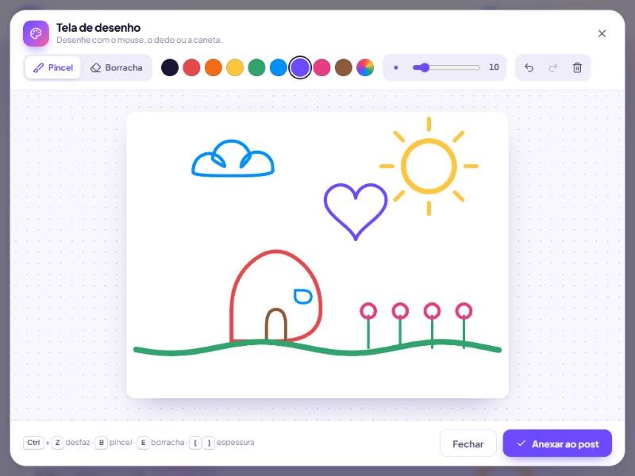
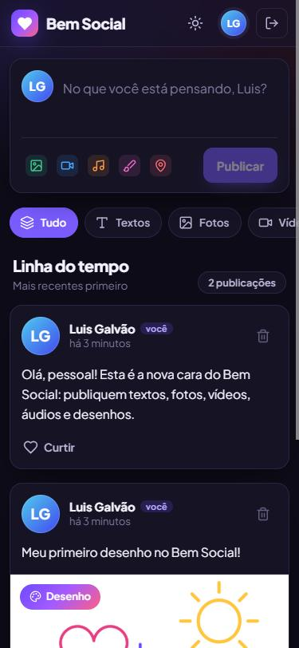
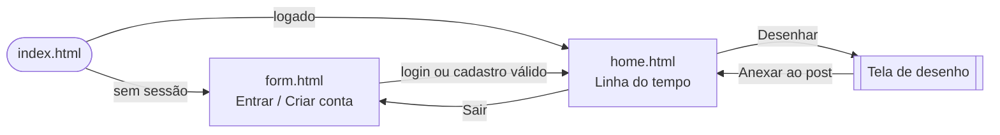

<div align="center">


# Bem Social

**Uma rede social que roda inteira no navegador — com textos, fotos, vídeos, áudios, localização e desenhos feitos à mão.**


[Sobre](#-sobre-o-projeto) ·
[Funcionalidades](#-funcionalidades) ·
[Telas](#%EF%B8%8F-telas) ·
[Como rodar](#-como-rodar) ·
[Tecnologias](#%EF%B8%8F-tecnologias-e-apis-do-navegador) ·
[Estrutura](#%EF%B8%8F-estrutura-do-projeto) ·
[Autor](#-autor)

<br>


</div>

---

## 📌 Sobre o projeto

O **Bem Social** nasceu como projeto da disciplina de *Web Standards* do curso de **Aplicações Ricas**. O enunciado conta a história do Seu Tadeu, um aposentado que quer lançar a própria rede social e precisa de um **protótipo moderno e atraente** para apresentar a investidores.

O diferencial pedido era ir além do texto: o usuário pode publicar **fotos, vídeos, áudios, a própria localização** e até **desenhar numa tela em branco e publicar o desenho** — tudo sem servidor, direto no navegador.

> [!NOTE]
> É um protótipo: não existe back-end. Contas, sessão e publicações ficam salvas **apenas no navegador** de quem usa (localStorage + IndexedDB). Não use senhas reais.

---

## ✨ Funcionalidades

### 🔐 Acesso (login e cadastro)

Uma única tela com abas animadas para **Entrar** e **Criar conta**, validação em tempo real e mensagens claras em cada campo.

| Campo | Regras |
| --- | --- |
| **Nome** | Obrigatório · 3 a 50 letras · apenas letras (aceita acentos) |
| **Email** | Obrigatório · formato válido · máximo de 30 caracteres · não pode repetir |
| **Senha** | Obrigatória · mínimo de 6 caracteres · ao menos 1 letra maiúscula e 1 número (checklist ao vivo) |
| **Confirmar senha** | Precisa ser igual à senha |
| **CPF** | Obrigatório · máscara `000.000.000-00` · só números · **validação dos dígitos verificadores** · não pode repetir |
| **Telefone** | Opcional · máscara `(00) 00000-0000` · valida DDD, celular (9 dígitos) e fixo |

Extras: mostrar/ocultar senha, animação de erro, redirecionamento automático para a linha do tempo e botão **Sair**.

### 📰 Linha do tempo

- Só aparece para quem está logado.
- Publicações em **ordem decrescente** (mais nova primeiro), com tempo relativo (“há 3 minutos”) que se atualiza sozinho.
- Cada publicação é exibida de acordo com o conteúdo: texto, foto, vídeo, áudio, desenho e/ou localização.
- **Curtir** com animação, **baixar** fotos e desenhos e **excluir** as próprias publicações (com botão **Desfazer**).
- **Filtros** por tipo: Tudo, Textos, Fotos, Vídeos, Áudios e Desenhos — com contadores.
- **Cartão de perfil** com avatar gerado pelas iniciais e estatísticas (publicações, desenhos e curtidas recebidas).

### ✍️ Criar publicação

| Tipo | Detalhes |
| --- | --- |
| **Texto** | Até 2000 caracteres · espaços sobrando no começo/fim são removidos · texto só com espaços é bloqueado · medidor circular de caracteres |
| **Foto** | Arquivos **JPG** ou **PNG** |
| **Vídeo** | Arquivos **MP4** |
| **Áudio** | Arquivos **MP3** |
| **Desenho** | Feito na própria tela de desenho (veja abaixo) |
| **Localização** | Coordenadas atuais do usuário, com link para abrir no mapa |

Atalho: <kbd>Ctrl</kbd> + <kbd>Enter</kbd> publica.

### 🎨 Tela de desenho

A grande novidade: um mini editor de desenho que abre por cima da página.

- **Pincel** e **borracha**
- **9 cores** prontas + seletor de qualquer outra cor
- **Espessura** de 2 a 64 px, com cursor redondo do tamanho real do pincel
- **Desfazer**, **refazer** e **limpar a tela**
- Funciona com **mouse, toque e caneta** (Pointer Events), com traço suavizado por curvas
- Tela deitada (4:3) no computador e **em pé (3:4) no celular**, em tela cheia
- O rascunho fica guardado ao fechar — dá para voltar e **editar** antes de publicar
- O desenho vira uma imagem **PNG** anexada ao post

| Atalho | Ação |
| --- | --- |
| <kbd>Ctrl</kbd> + <kbd>Z</kbd> | Desfazer |
| <kbd>Ctrl</kbd> + <kbd>Y</kbd> ou <kbd>Ctrl</kbd> + <kbd>Shift</kbd> + <kbd>Z</kbd> | Refazer |
| <kbd>B</kbd> / <kbd>E</kbd> | Pincel / Borracha |
| <kbd>[</kbd> / <kbd>]</kbd> | Diminuir / aumentar a espessura |

### 💅 Design e experiência

- Visual moderno com gradiente da marca, cartões, sombras suaves e a fonte *Plus Jakarta Sans*.
- **Tema claro e escuro** (segue o sistema e pode ser trocado no botão ☀️/🌙).
- **Animações** de entrada de página, troca de abas, novos posts, curtidas, toasts e transição entre telas.
- **Responsivo**: layout em duas colunas no computador e adaptado para celular (filtros em “chips”, editor compacto, desenho em tela cheia).
- **Acessível**: navegação por teclado, foco visível, rótulos ARIA e respeito à preferência de *movimento reduzido*.

---

## 🖼️ Telas

<table>
  <tr>
    <td align="center"><b>Login e cadastro</b></td>
    <td align="center"><b>Tela de desenho</b></td>
  </tr>
  <tr>
    <td></td>
    <td></td>
  </tr>
  <tr>
    <td align="center"><b>Linha do tempo</b></td>
    <td align="center"><b>Celular · tema escuro</b></td>
  </tr>
  <tr>
    <td></td>
    <td align="center"></td>
  </tr>
</table>

### Fluxo de navegação



---

## 🚀 Como rodar

Não há instalação nem build: são só arquivos HTML, CSS e JavaScript.

**1. Clone o repositório**

```bash
git clone https://github.com/Sasuzin/MidiaSocial.git
cd MidiaSocial/ProjetoARI
```

**2. Suba um servidor local** (recomendado — a localização só funciona em `localhost` ou HTTPS)

```bash
python -m http.server 5500
```

**3. Abra no navegador:** <http://localhost:5500>

> [!TIP]
> No VS Code, a extensão **Live Server** faz o mesmo com um clique.

### 🌐 Publicar no GitHub Pages

O projeto é 100% estático, então roda no GitHub Pages sem nenhuma adaptação. O `index.html` da raiz do repositório leva o visitante direto para a pasta `ProjetoARI/`.

1. No GitHub, abra **Settings → Pages**.
2. Em **Build and deployment**, escolha **Deploy from a branch**.
3. Selecione a branch (ex.: `main`) e a pasta **`/ (root)`** — não use `/docs`, que guarda só as imagens deste README.
4. Salve e aguarde alguns minutos: o site fica em `https://<usuario>.github.io/MidiaSocial/`.

---

## 🛠️ Tecnologias e APIs do navegador

| Camada | O que foi usado |
| --- | --- |
| **Estrutura** | HTML5 semântico, `<dialog>`, sprite de ícones SVG ([Lucide](https://lucide.dev)) |
| **Estilo** | CSS3 com variáveis (design tokens), Grid, Flexbox, *container queries*, `color-mix()`, `backdrop-filter` e animações |
| **Lógica** | JavaScript puro (ES2020+), sem frameworks nem bibliotecas |
| **Desenho** | Canvas 2D + Pointer Events (mouse, toque e caneta) |
| **Dados** | `localStorage` (usuários, sessão, tema) e **IndexedDB** (publicações e arquivos de mídia) |
| **Recursos** | Geolocation API, File API / Blob / Object URLs, `Intl.RelativeTimeFormat`, View Transitions API |

### 💾 Onde os dados ficam

| Armazenamento | Chave | Conteúdo |
| --- | --- | --- |
| localStorage | `Users` | Lista de contas cadastradas |
| localStorage | `usuarioLogado` | Email de quem está logado |
| localStorage | `tema` | Tema escolhido (`light` / `dark`) |
| IndexedDB | `bem-social` → `posts` | Publicações, curtidas e mídias (fotos, vídeos, áudios e desenhos) |

O IndexedDB foi escolhido para as publicações porque guarda arquivos grandes (como vídeos) sem estourar o limite de ~5 MB do localStorage.

---

## 🗂️ Estrutura do projeto

```text
MidiaSocial/
├── README.md
├── index.html                # redireciona para ProjetoARI/ (GitHub Pages)
├── docs/
│   └── screenshots/          # imagens usadas neste README
└── ProjetoARI/
    ├── index.html            # redireciona para login ou linha do tempo
    ├── form.html             # login + cadastro
    ├── home.html             # linha do tempo + tela de desenho
    ├── CSS/
    │   ├── base.css          # tokens de design, temas, botões, toasts, animações
    │   ├── form.css          # página de acesso
    │   └── home.css          # linha do tempo, editor, posts e tela de desenho
    ├── JS/
    │   ├── storage.js        # usuários, sessão (localStorage) e posts (IndexedDB)
    │   ├── ui.js             # ícones, avatares, toasts, tema e transições
    │   ├── form.js           # abas, máscaras e validações do login/cadastro
    │   ├── drawing.js        # estúdio de desenho (canvas)
    │   └── home.js           # editor de publicação, feed, filtros, curtidas
    └── Imagens/              # logo, favicon e ícones
```

---

## 🧭 Próximos passos

- [ ] Transformar em **PWA** (manifest + service worker) para instalar na tela inicial do celular
- [ ] Publicar no **GitHub Pages**
- [ ] Comentários nas publicações
- [ ] Mais ferramentas de desenho (balde de tinta, formas, texto)

---

## 💜 Autor

<div align="center">

Desenvolvido por **Luis Galvão**

[](https://www.linkedin.com/in/luis-galv%C3%A3o/)

<sub>Feito com 💜 para a disciplina de Aplicações Ricas.</sub>

</div>
